# Evidências

Prints e saídas de comandos que comprovam o funcionamento da POC. Cada item diz **o que a imagem mostra** e **o que ela prova**.
Os itens marcados com `[ ]` ainda não têm evidência salva.

## Mapa: critérios do desafio → evidências

| Critério de avaliação / diferencial | Itens |
|---|---|
| Cluster e Ingress funcionais | 1, 8 |
| Pipeline ponta a ponta (SAST, scan, deploy) | 2, 3, 4, 5, 6 |
| Observabilidade (métricas, logs, alertas) | 11, 12, 13, 14 |
| Segurança (Kyverno, Cosign) | 5, 9, 10 |
| GitOps com ArgoCD | 6 |
| Canary / Rollback automático | 7, 15, 16 |
| Ambiente reprodutível | 17 |

## Checklist

| # | Evidência | Arquivo | Feito |
|---|---|---|---|
| 1 | Cluster e pods | 01-cluster.png | [x] |
| 2 | Pipeline com 4 jobs verdes | 02-pipeline.png (+ 02-pipeline-runner.png) | [x] |
| 3 | SonarQube: Quality Gate | 03-sonarqube.png | [x] |
| 4 | Trivy: scan da imagem | 04-trivy.png | [x] |
| 5 | Harbor: imagem assinada | 05-harbor.png | [x] |
| 6 | ArgoCD: Synced/Healthy | 06-argocd.png | [x] |
| 7 | Canary concluído | 07-canary.png | [x] |
| 8 | Aplicação respondendo | 08-app.png | [x] |
| 9 | Kyverno bloqueia `:latest` | 09-kyverno-latest.png | [x] |
| 10 | Kyverno bloqueia imagem não assinada | 10-kyverno-cosign.png | [x] |
| 11 | Dashboard Grafana | 11-grafana.png | [x] |
| 12 | Logs no Loki | 12-loki.png | [x] |
| 13 | Regras de alerta no Prometheus | 13-alerta.png | [x] |
| 14 | HPA escalando | 14-hpa.png | [x] |
| 15 | Rollback manual | 15-rollback.png | [x] |
| 16 | Rollback **automático** | 16-rollback-automatico.png (+ 16b, 16c) | [x] |
| 17 | Smoke test 13/13 | 17-smoke-test.txt | [x] |

---

## Descrição de cada evidência

### 1. Cluster e pods
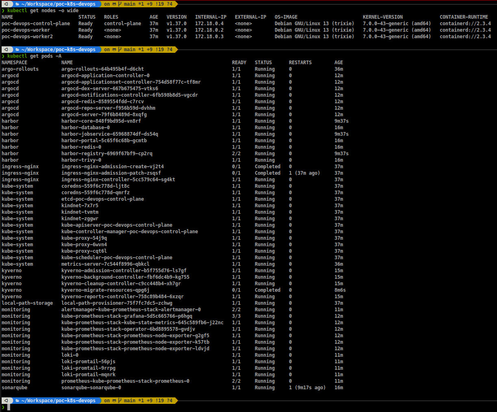

`kubectl get nodes -o wide` e `kubectl get pods -A`. Mostra o cluster kind com **3 nós `Ready`** (1 control-plane e 2 workers) e todos os
componentes da plataforma em `Running`: Argo CD, Argo Rollouts, Harbor (com Trivy), Ingress NGINX, Kyverno, Prometheus/Alertmanager/Grafana,
Loki/Promtail, metrics-server e SonarQube. Os pods `Completed` são jobs de instalação (admission do ingress e migração do Kyverno).

### 2. Pipeline CI/CD
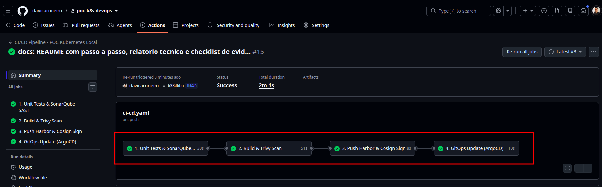

Execução do GitHub Actions com **os 4 jobs em verde** em 2 min 1 s: *1. Unit Tests & SonarQube SAST* (38 s), *2. Build & Trivy Scan* (51 s),
*3. Push Harbor & Cosign Sign* (8 s) e *4. GitOps Update (ArgoCD)* (10 s).

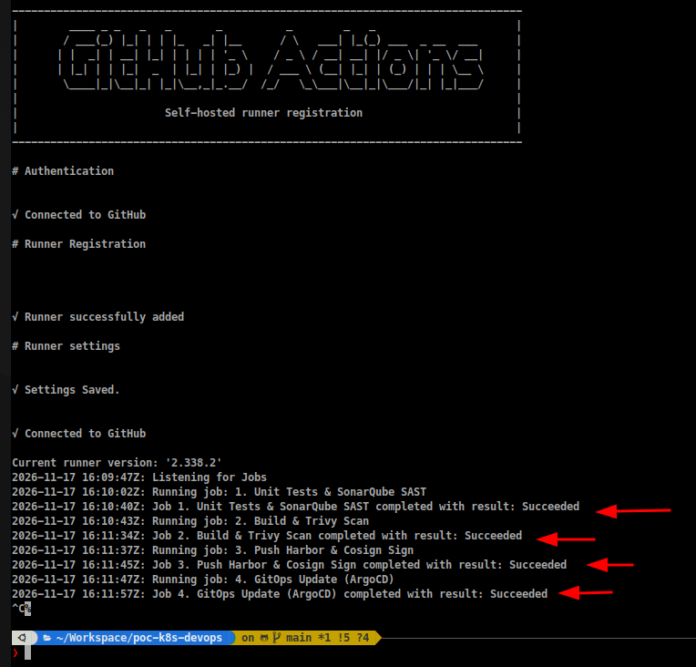

Log do **runner self-hosted** rodando na máquina local: `Listening for Jobs` e os 4 jobs concluídos com `Succeeded`. Comprova que o
pipeline roda em infraestrutura local, sem Cloud.

### 3. SonarQube (SAST)
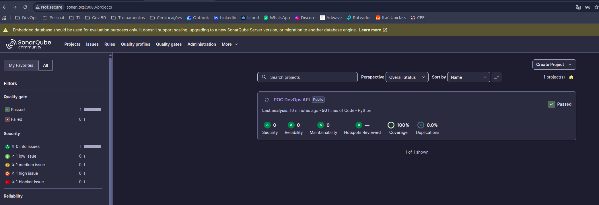

Projeto *POC DevOps API* com **Quality Gate: Passed**: Security A (0), Reliability A (0), Maintainability A (0), **cobertura de 100%** e
**0,0% de duplicação**. Comprova a análise estática e a cobertura de testes, ambas bloqueantes no pipeline.

### 4. Trivy (scan da imagem)
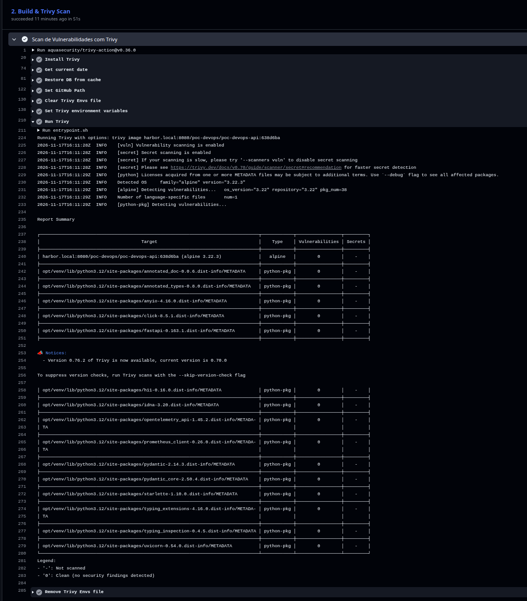

Log do step *Scan de Vulnerabilidades com Trivy*: imagem `poc-devops-api:638d6ba` sobre Alpine 3.22.3, com **0 vulnerabilidades** no sistema
operacional e em todas as dependências Python (fastapi, starlette, uvicorn, prometheus_client etc.) e varredura de segredos habilitada. O scan
roda **antes** do push, então uma imagem vulnerável nunca chega ao registry.

### 5. Harbor com imagem assinada
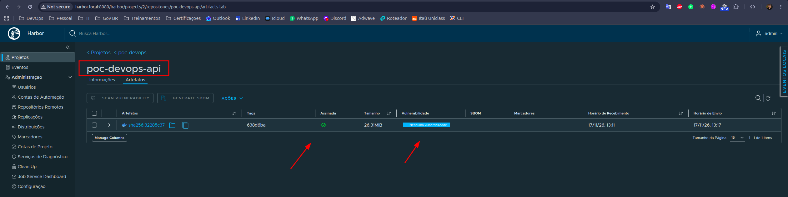

Repositório `poc-devops/poc-devops-api` no Harbor com o artefato de tag `638d6ba` (26,31 MiB). A coluna **Assinada** exibe o ícone verde
(assinatura Cosign) e a coluna **Vulnerabilidade** mostra "Nenhuma vulnerabilidade" (scan do próprio Harbor). Comprova o registry local, o push
e a assinatura da imagem.

### 6. ArgoCD (GitOps)
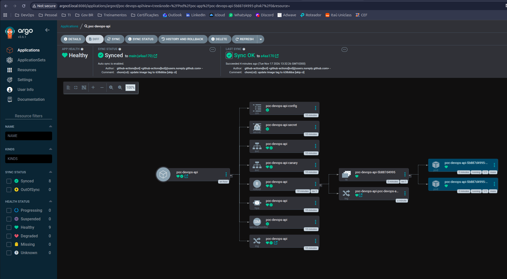

Aplicação `poc-devops-api` **Healthy** e **Synced** à `main`, com auto-sync ligado. O *Last Sync* foi disparado pelo commit do bot
`chore(cd): update image tag to 638d6ba [skip ci]`, o que comprova o fluxo GitOps: o pipeline altera o Git e o ArgoCD aplica. A árvore mostra
todos os recursos do chart: ConfigMap, Secret, dois Services (estável e canary), Rollout, HPA, ServiceMonitor, Ingress, ReplicaSet e pods.

### 7. Canary concluído
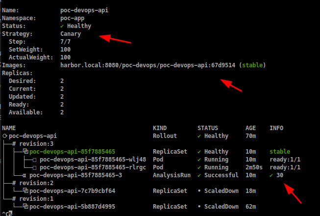

`kubectl argo rollouts get rollout`: estratégia **Canary** finalizada (`Step 7/7`, peso 100%), versão `stable` com 2 pods e o
**AnalysisRun com 30 medições bem-sucedidas** no Prometheus. Comprova a entrega progressiva com análise automática.

### 8. Aplicação respondendo
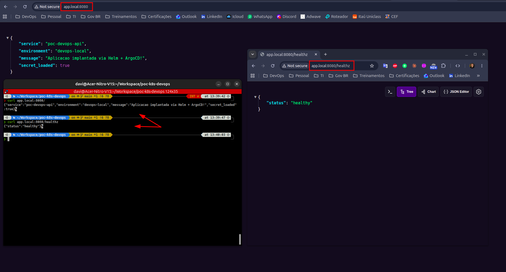

`curl` e navegador em `app.local:8080`. A rota `/` devolve `"environment": "devops-local"`, a mensagem vinda do **ConfigMap** e
**`"secret_loaded": true`** (variável do **Secret**), e `/healthz` devolve `{"status":"healthy"}`. Comprova o Ingress funcional e que o
ConfigMap e o Secret chegam à aplicação.

### 9. Kyverno bloqueia `:latest`
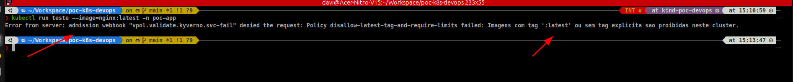

`kubectl run teste --image=nginx:latest -n poc-app` é **negado pelo admission webhook do Kyverno**:
`Policy disallow-latest-tag-and-require-limits failed: Imagens com tag ':latest' ou sem tag explicita sao proibidas neste cluster.`
Comprova a política mínima exigida pelo desafio (proibir `:latest`), aplicada no namespace da aplicação.

### 10. Kyverno bloqueia imagem não assinada
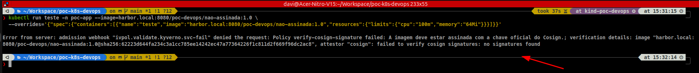

Uma imagem **real**, publicada no Harbor (`nao-assinada:1.0`, digest `sha256:62223d...` resolvido), mas **sem assinatura Cosign**, é **negada** pelo
admission webhook: `Policy verify-cosign-signature failed: A imagem deve estar assinada com a chave oficial do Cosign.` e, nos detalhes,
`failed to verify cosign signatures: no signatures found`. O pod de teste declara `resources.limits` para que a negação venha da verificação de
assinatura, e não da política de limits. Comprova que só imagens assinadas pelo pipeline rodam no cluster.

### 11. Dashboard do Grafana
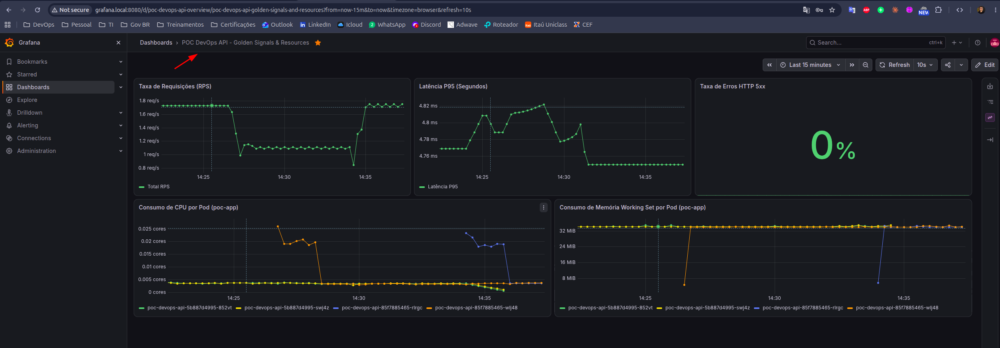

Dashboard *POC DevOps API - Golden Signals & Resources* (últimos 15 min, refresh de 10 s) com os cinco painéis alimentados por dados reais:
taxa de requisições (~1,8 req/s), latência P95 (~4,8 ms), taxa de erros 5xx (0%), CPU e memória por pod. Os pods de duas revisões
(`5b887d4995` e `85f7885465`) aparecem na transição de um deploy.

### 12. Logs no Loki
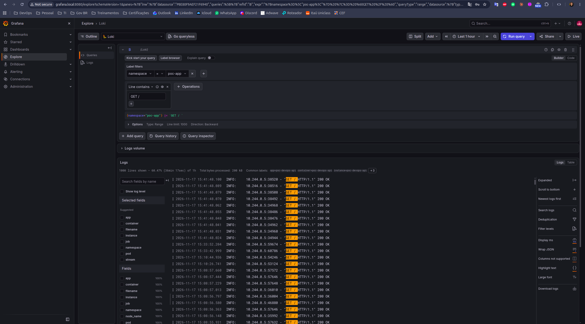

Grafana → *Explore* com o datasource **Loki**, consulta `{namespace="poc-app"} |= "GET / "` na última hora (1000 linhas exibidas). As linhas
`GET / HTTP/1.1" 200 OK` são os logs da aplicação coletados pelo **Promtail**, com os rótulos `app`, `container`, `instance`, `namespace`, `pod` e
`node_name`. A origem das requisições (`10.244.0.5`) é o pod do Ingress NGINX, o que mostra o caminho Ingress → aplicação. Comprova a
centralização de logs (Loki/Promtail) consultável no mesmo Grafana das métricas.

### 13. Regras de alerta no Prometheus
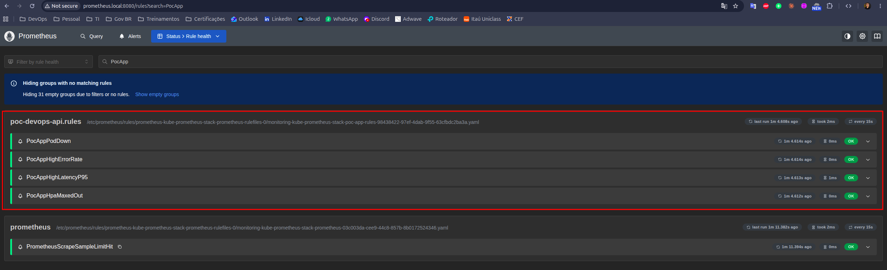

Página *Status › Rule health* filtrada por `PocApp`. O grupo **`poc-devops-api.rules`** (destacado) carrega as **4 regras** da aplicação, todas com saúde
**OK** e avaliadas a cada 15 s: `PocAppPodDown`, `PocAppHighErrorRate` (5xx acima de 5%), `PocAppHighLatencyP95` (P95 acima de 500 ms) e
`PocAppHpaMaxedOut` (HPA no limite máximo). A regra `PrometheusScrapeSampleLimitHit` abaixo é padrão da stack e aparece só por causa da busca aproximada.

### 14. HPA escalando
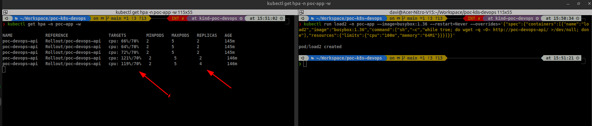

À esquerda, `kubectl get hpa -n poc-app -w`: com a carga gerada por pods `busybox` dentro do cluster (à direita, criação do `load2`), a utilização de CPU
passa de 66% para **121%** do alvo de 70% e o HPA aumenta as réplicas do Rollout de **2 para 4** (limites: mínimo 2, máximo 5). Comprova o
autoscaling horizontal funcionando com o metrics-server.

### 15. Rollback manual
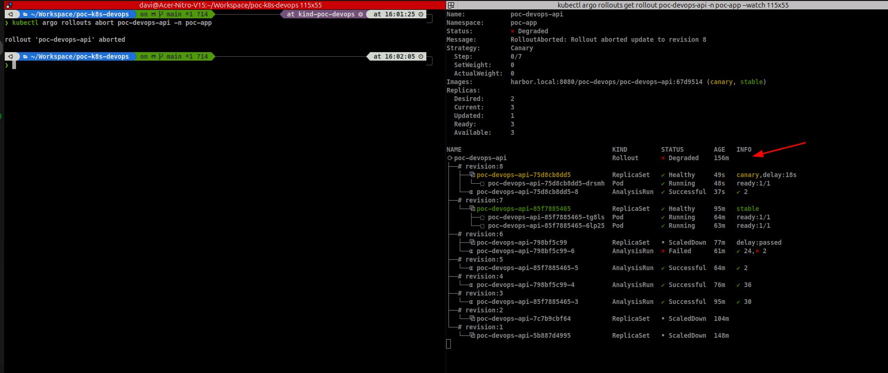

Com um canary em andamento (nova revisão 8, gerada pela troca da mensagem no ConfigMap), o comando `kubectl argo rollouts abort poc-devops-api -n poc-app`
(à esquerda) devolve `rollout 'poc-devops-api' aborted`. À direita, o Rollout fica **Degraded** com `RolloutAborted: Rollout aborted update to revision 8`,
`Step 0/7` e **peso 0%**: o ReplicaSet da versão estável (`85f7885465`, 2 pods) segue servindo todo o tráfego. Diferente do item 16, aqui a decisão é humana.

### 16. Rollback automático (canary reprovado pela análise)
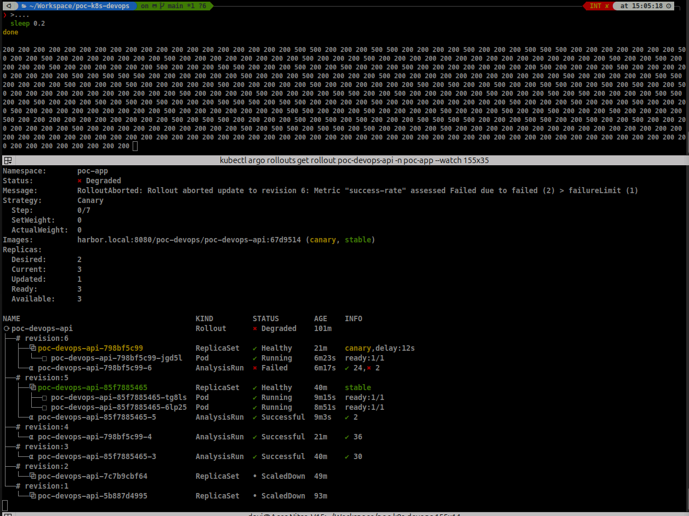

Demonstração com a taxa de erro simulada ligada (`APP_ERROR_RATE=1`) e tráfego contínuo. **Acima:** o loop de `curl` mostra respostas `200`
misturadas com `500`, vindas do canary a 25%. **Abaixo:** o Argo Rollouts reprova a nova revisão sozinho: o `AnalysisRun` fica **`✖ Failed`**
(24 medições boas e 2 ruins) e o Rollout vai para **Degraded** com a mensagem
`RolloutAborted: Metric "success-rate" assessed Failed due to failed (2) > failureLimit (1)`. O peso do canary cai para 0 (`Step 0/7`).

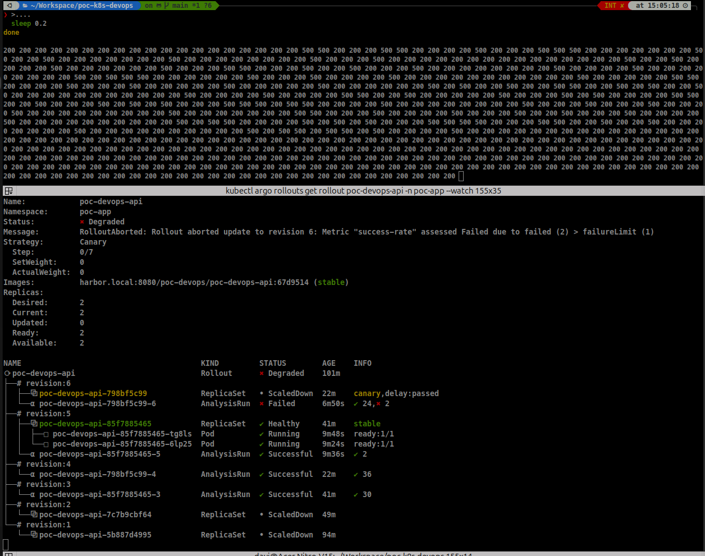

Instantes depois: o ReplicaSet do canary está em `ScaledDown`, só a versão estável (2 pods) serve tráfego e o loop volta a mostrar **somente
`200`**. Prova que o rollback foi automático e que os usuários deixaram de receber erros, sem intervenção manual.

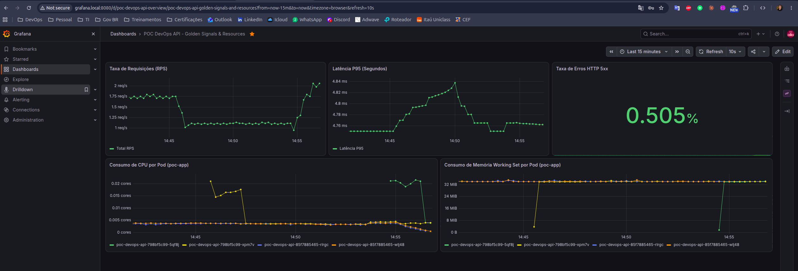

Dashboard do Grafana com **taxa de 5xx de 0,505%** durante a primeira tentativa de teste da falha (janela 14:41–14:56). Mostra os pods das
duas revisões (`5b887d4995`/`85f7885465` e a nova `798bf5c99`). É uma captura complementar e **não** é da execução final acima.

### 17. Smoke test
Arquivo [17-smoke-test.txt](17-smoke-test.txt): saída do `make smoke-test` com **13 verificações, 0 falhas** (nós, app, secret, métricas,
ArgoCD, Rollout, HPA, as duas políticas do Kyverno, Prometheus, Grafana e Loki).
